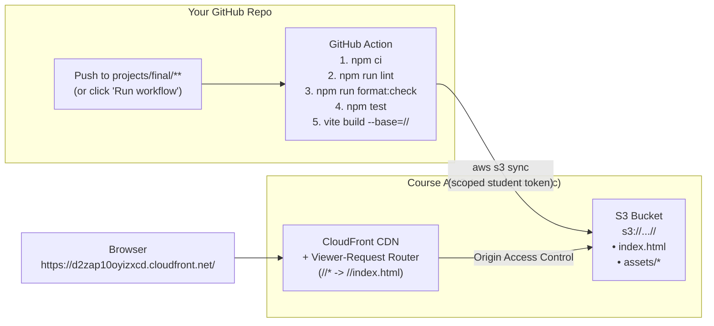

# Final Project Hosting and Deployment

> **Note on AI authorship:** I used Antigravity and Gemini 4 to generate the build infrastructure
> and deployment plans described here. Gemini 4 Argon drafted this document, and I edited it.

For the final project, your built application in `projects/final` is deployed to a shared AWS
hosting environment. Once deployed, your app runs at:

```
https://d2zap10oyizxcd.cloudfront.net/<your-last-name>
```

For example, if your repository is `phillips-cocc-js`, your app is served at
`https://d2zap10oyizxcd.cloudfront.net/phillips`.

## Architecture and Build Workflow



## Pulling the Deployment Setup into Your Repo

### 1. Fetch the latest course template updates on `main`

From the root of your course repository:

```bash
git checkout main
git status
git fetch template
git checkout template/main -- :/
git commit -m "updates from course template"
git push origin main
```

Pushing this update to `main` registers `.github/workflows/deploy-final.yml` with GitHub so the
**Deploy Final Project** workflow appears under your repository's **Actions** tab.

If you are already working on a feature branch for your final project, merge `main` into that branch
so it has the workflow too:

```bash
git checkout final
git merge main
```

### 2. Create or update `projects/final`

If you haven't created `projects/final` yet, generate it from the starter kit using the root `npm`
task:

```bash
npm run weekly:create final
cd projects/final
npm install
```

If you already created `projects/final` earlier in the term, copy the updated `package.json` and
`eslint.config.js` from `starter/` so your project has the `lint`, `lint:fix`, `format:check`, and
`check` scripts:

```bash
cp starter/package.json starter/eslint.config.js projects/final/
cd projects/final
npm install
```

### 3. Run the build checks locally before pushing

I added an `npm run check` script to `starter/package.json` that runs the exact same checks as the
GitHub Action, without modifying any files:

```bash
cd projects/final
npm run check
```

Under the hood, `npm run check` runs four steps in order:

1. `npm run lint` — checks for syntax and scope problems with ESLint (you can auto-fix safe lint
   issues with `npm run lint:fix`)
2. `npm run format:check` — checks that files are formatted with Prettier (if this fails, run
   `npm run format` to fix them)
3. `npm test` — runs your Vitest unit tests once
4. `npm run build` — runs `vite build` to verify the production bundle compiles cleanly

### 4. Triggering a deployment

I will add all student AWS deployment tokens directly to your repositories' GitHub secrets. Once
your token is in place, your project deploys in two ways:

- **Automatically on push:** Any push (on any branch) that modifies files inside `projects/final/`
  triggers the workflow.
- **Manually from GitHub:** Open your repository on GitHub, click **Actions** → **Deploy Final
  Project** → **Run workflow**, select your branch from the dropdown, and click **Run workflow**.

When all checks pass, the workflow builds your project with `vite build --base="/<your-last-name>/"`
and uploads `projects/final/dist/` to your folder in the S3 bucket.

## Client-Side Routing in a Single-Page Application (SPA)

In Week 10, we will discuss Single-Page Application (SPA) client-side routing and
[Navigo](https://github.com/krasimir/navigo) as an optional aside, should you want to incorporate
multiple views or pages in your final project.

Because your app lives under `/<your-last-name>` rather than at the root of the domain, the
CloudFront router function ([`infra/lib/student-hosting-stack.ts`](lib/student-hosting-stack.ts))
rewrites any request without a file extension (such as `/phillips` or `/phillips/items/42`) to
`/phillips/index.html`. Static files with extensions (`.js`, `.css`, `.png`, `.svg`) are served
directly from S3.

If you use Navigo for client-side routing, pass `import.meta.env.BASE_URL` as the root URL:

```js
import Navigo from 'navigo'

const router = new Navigo(import.meta.env.BASE_URL)

router
  .on('/', () => {
    // Home view
  })
  .on('/items/:id', ({ data }) => {
    // Detail view for data.id
  })
  .resolve()
```

Vite sets `import.meta.env.BASE_URL` to `'/'` during local development (`npm start`) and to
`'/<your-last-name>/'` during the GitHub Action build, so your routes work in both places without
code changes.

## Exploring the Infrastructure Code

If you're curious about how the hosting infrastructure is set up, everything is included right here
in the repo:

- [`.github/workflows/deploy-final.yml`](../.github/workflows/deploy-final.yml) — the GitHub Action
  that installs dependencies, runs `lint`, `format:check`, `test`, builds with Vite, and syncs
  `dist/` to S3.
- [`infra/lib/student-hosting-stack.ts`](lib/student-hosting-stack.ts) — the AWS Cloud Development
  Kit (CDK) stack that defines the S3 bucket, CloudFront CDN distribution, and the `viewer-request`
  routing function.
- [`infra/scripts/issue-student-token.sh`](scripts/issue-student-token.sh) — the script I run to
  create each student's AWS IAM user with an inline security policy restricting uploads to that
  student's `s3://.../<slug>/*` folder.
